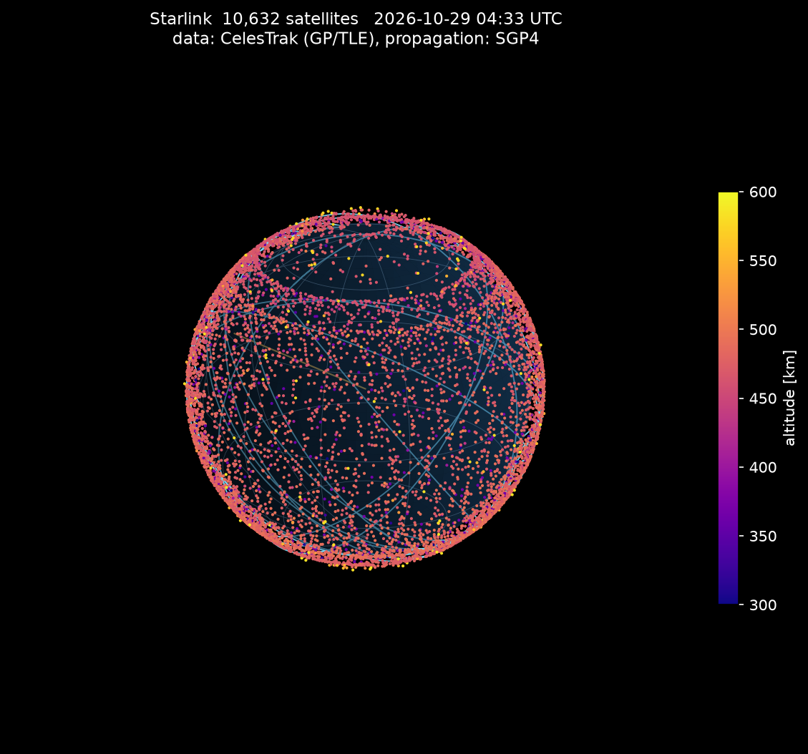

# starlink-orbits

Starlink 衛星(約1万機)の軌道データを取得し、地球のモデル上に現在位置と軌道を描く Python スクリプトです。



## 特徴

- 1ファイル・依存は [sgp4](https://pypi.org/project/sgp4/) / numpy / matplotlib
- 軌道データは [CelesTrak](https://celestrak.org/) の Starlink グループ(TLE 形式)を取得し、ローカルにキャッシュ
- 任意の UTC 時刻での位置を SGP4 で計算し、高度で色分けして 3D または 2D(緯度経度)に描く
- 3D では地球の裏側にある衛星・軌道線を隠して見やすくする

## 必要なもの

- Python 3.10 以上

```sh
python -m venv .venv
. .venv/bin/activate        # Windows は .venv\Scripts\activate
pip install sgp4 numpy matplotlib
```

## 使い方

```sh
python starlink_orbits.py                      # 現在時刻、3D、軌道線12本 → starlink_3d.png
python starlink_orbits.py --map                # 緯度経度の2D散布図 → starlink_map.png
python starlink_orbits.py --time 2026-10-29T12:00 --tracks 0
python starlink_orbits.py --elev 60 --azim 200 --out pole.png   # 北極寄りから見る
```

### オプション

| オプション | 既定値 | 説明 |
| --- | --- | --- |
| `--time T` | 現在 | UTC 時刻(ISO 形式)。TLE の元期から離れるほど精度は落ちる |
| `--tracks N` | `12` | 約1周分の軌道線を描く衛星の数。全体から均等に抜き出す。`0` で描かない |
| `--map` | | 3D の代わりに緯度経度の2D散布図を出す |
| `--elev E` / `--azim A` | `25` / `135` | 3D の視点(仰角・方位角、度) |
| `--out FILE` | `starlink_3d.png` / `starlink_map.png` | 出力ファイル名 |
| `--refresh` | | キャッシュを無視して TLE を取り直す |
| `--max-age H` | `6` | キャッシュをそのまま使う上限時間 |

## しくみ

1. CelesTrak から Starlink の TLE(2行軌道要素)をまとめて取得し `starlink.tle` に保存
2. 各衛星の TLE を sgp4 ライブラリに渡し、指定時刻の位置(TEME 慣性座標、km)を一括計算
3. グリニッジ平均恒星時ぶん z 軸まわりに回して地球固定座標(ECEF)へ変換
4. ECEF から緯度・経度・高度を求め、高度で色分けして描画

軌道線は、その衛星を1分刻みで約96分ぶん進めた位置を、描画時刻の恒星時で固定して回したものです。つまり「その瞬間の地球に対して軌道面がどう傾いているか」を示しており、地表に対する軌跡(地上軌跡)ではありません。

## 「約1万機」の中身

CelesTrak の Starlink グループに入っているのは、アメリカの宇宙監視網(Space-Track)が追跡していてカタログ番号が付いており、まだ軌道上にある Starlink の物体です。2026-10-29 時点で 10,632 機でした。中身はこう混ざっています。

- **運用中の衛星** が大半。高度 約550 km の軌道でインターネットを中継しているものです
- **打ち上げ直後で高度を上げている途中** のもの。ロケットから放たれた直後は低い軌道にいて、数週間かけて自力で上がります
- **寿命や故障で高度を下げている途中** のもの。大気圏に入って燃え尽きるまでは軌道上にあるので数に入ります

**数に入らないもの:** すでに大気圏に再突入して燃え尽きた衛星は、カタログから「decayed」扱いで消えます。SpaceX の打ち上げ総数はこれより多く、このツールが扱うのは「今いる数」です。

この数は毎週のように変わります。数日おきに 20〜30 機ずつ打ち上げられる一方で古い衛星が落ちているので、取得した時点の件数は `loaded ... TLEs` として実行時に表示します。

## 注意

- CelesTrak のデータ更新は約2時間おきです。短い間隔で何度も取りに行くとアクセスを制限されることがあるため、既定ではキャッシュを6時間使い回します。
- SGP4 の精度は TLE の元期(観測時刻)から離れるほど落ちます。数日以上先や前の時刻を指定した結果は目安です。
- `sgp4` がエラーを返した衛星(大気圏再突入済みなど)は描画から外し、件数だけ表示します。
- 高度の計算は地球を半径 6371 km の球として扱っています。描画用途には十分ですが、測地系としては正確ではありません。

## 次にやりたいこと

- Jupyter Notebook で読み込んで、視点や時刻を変えながら対話的に眺める
- 時刻を進めて衛星が動くアニメーション GIF(himawari-gif と同じ Pillow の手口)
- CesiumJS でブラウザ上の回る地球儀に載せる

## 出典

軌道データ: [CelesTrak](https://celestrak.org/NORAD/elements/) (GP data, Starlink group)
